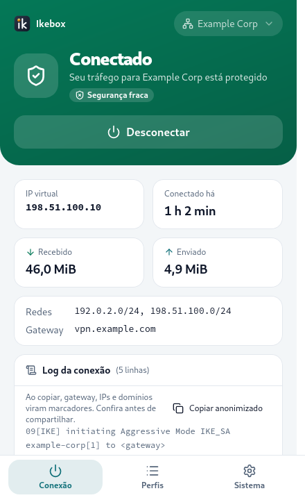
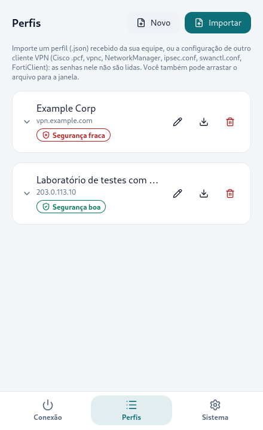
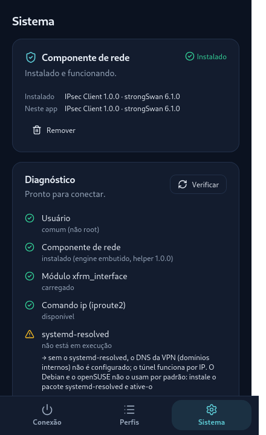

<p align="center"></p>

# Ikebox — Cliente de VPN IPsec isolado para Linux (IKEv1 legado e IKEv2)

Português · **[English](README.md)**

**IKE** numa **caixa** (*box*): o motor IKE do [strongSwan](https://www.strongswan.org/),
rodando numa caixa isolada e sem root. Até a 0.9 o projeto se chamava
*IPsec Client*; atualizar a partir dele mantém os seus perfis e as
credenciais guardadas.

Cliente de VPN IPsec para **Linux**, feito para VPNs **legadas**: IKEv1, modo
agressivo, PSK de grupo + XAuth, grupos DH antigos. É o tipo de VPN corporativa
que os clientes atuais do Linux já não conseguem conectar.

Ele conecta em **IKEv1** (modo agressivo ou principal, PSK de grupo com
XAuth, o seu certificado) e em **IKEv2** (PSK, usuário e senha com EAP, o seu
certificado em arquivo ou num **smartcard ou token**), com o próprio
strongSwan dentro: nada para configurar no sistema, sem Docker. Os perfis
podem ser compartilhados com colegas (sem credenciais), criados no app a
partir de modelos de fornecedor, ou importados de Cisco `.pcf`, vpnc,
NetworkManager, `ipsec.conf` e FortiClient. Todos os modos são testados de
ponta a ponta, e o motor, em sete distribuições.

<p align="center">
  
  
  
</p>

Downloads: [Releases](https://github.com/lucastelso/ikebox/releases)
(AppImage, `.deb`, `.rpm`, assinados). O que mudou:
[CHANGELOG](CHANGELOG.md) (em inglês). Chave das versões
([packaging/keys](packaging/keys/)): `6F3F 99EA 25FA F76F CF98  655C B357 4751 2185 8FC5`.

---

## Por que este projeto existe

Muitas empresas e órgãos públicos ainda usam concentradores VPN (por exemplo,
FortiGate) configurados com IKEv1 e algoritmos antigos. No Windows e no macOS,
o fabricante oferece um cliente oficial, como o FortiClient. No Linux, o
suporte foi abandonado. E as ferramentas nativas não ajudam:

- as distribuições atuais, com suas políticas de criptografia, recusam ou já
  não oferecem esses algoritmos;
- o NetworkManager não cobre bem a combinação **PSK de grupo + XAuth em modo
  agressivo**.

O Ikebox resolve isso trazendo o **próprio strongSwan** (6.1.0,
compilado a partir do código-fonte oficial). Ele mantém os algoritmos legados
sem rebaixar nada no sistema. Para o usuário, é um app com perfis, credenciais
guardadas com segurança, diagnóstico e ícone na bandeja.

## Para quem é

- **Usuários de Linux** que precisam acessar uma VPN IPsec corporativa sem
  cliente oficial para Linux.
- **Equipes** que querem distribuir um perfil pronto para os colegas, com
  gateway, propostas, rotas e DNS. Cada pessoa só informa as próprias
  credenciais.
- **Quem automatiza:** existe uma linha de comando (`ikebox-cli`) com a
  mesma lógica do app.

### Para quem não é

| Caso | Use |
|---|---|
| VPN SSL do FortiGate (SSL-VPN) | [openfortivpn](https://github.com/adrienverge/openfortivpn) |
| L2TP/IPsec, OpenVPN, WireGuard | Fora do escopo: há bons clientes nativos |
| Windows / macOS | O cliente oficial do fabricante |

## Instalação

Baixe o arquivo da sua distribuição na página [Releases](https://github.com/lucastelso/ikebox/releases):

| Sua distribuição | Arquivo | Como instalar |
|---|---|---|
| Fedora, openSUSE, RHEL 10 (com EPEL) | `.rpm` | `sudo dnf install ./ikebox-*.x86_64.rpm` |
| Ubuntu, Debian, Mint | `.deb` | `sudo apt install ./ikebox_*_amd64.deb` |
| Outras | `.AppImage` | `chmod +x` e abrir |

Depois, abra o **Ikebox** pelo menu de aplicativos. Com o `.rpm` ou o
`.deb`, o próprio pacote instala o componente de rede (a parte que roda a
VPN); com o AppImage, o app pede a senha de administrador **uma vez** para
instalá-lo.

Toda versão é assinada: confira o download com o `SHA256SUMS.asc` e a chave
do projeto, ou com o `gh attestation verify`
([como](docs/pt-BR/instalacao.md#conferir-o-download)).

O passo a passo completo, com primeiro uso, atualização, desinstalação e
como gerar os pacotes a partir do código, está no
**[manual de instalação](docs/pt-BR/instalacao.md)**.

> Recebeu um perfil de um colega? Siga o **[guia rápido](docs/pt-BR/guia-rapido.md)**.

## Idiomas

O app segue o idioma do sistema: português num sistema em português, inglês
em qualquer outro. Para trocar, vá em **Sistema → Aparência → Idioma**. A
linha de comando fala inglês. A documentação de usuário existe nos dois
idiomas (em português, em [docs/pt-BR](docs/pt-BR/)); a documentação técnica
está em inglês.

## Como funciona

```
┌──────────────────────────────── host Linux ─────────────────────────────────┐
│  Ikebox (app)  ou  ikebox-cli                (seu usuário)      │
│     │ perfis: ~/.config/ikebox   credenciais: chaveiro do sistema     │
│     │ "suba o engine" (socket + polkit)      │ VICI (socket 0600, só seu)   │
│     ▼                                        │                              │
│  ikebox-helper (root, API mínima)      │                              │
│     │ systemd-run, com sandbox               ▼                              │
│     └──► charon (strongSwan 6.1.0 embutido) ── updown → rotas + DNS         │
│              │ SAs e políticas XFRM (com if_id)                             │
│              ▼                                                              │
│  kernel: interface ipsc0 (XFRM) ═══════ ESP/UDP 4500 ═══════► gateway VPN   │
└─────────────────────────────────────────────────────────────────────────────┘
```

- **Conectar:**
  - o app pede ao **componente de rede** (o helper) que suba o strongSwan;
  - o helper confere quem pediu (polkit) e sobe o strongSwan como um serviço
    temporário do systemd, isolado, só com as permissões de rede;
  - o app entrega o perfil e as credenciais ao strongSwan em memória, pelo
    socket de controle (VICI), e inicia a negociação.
- **Conectado:**
  - o IP virtual, as rotas e o DNS da VPN ficam na interface dedicada `ipsc0`;
  - a sua interface Wi-Fi/Ethernet não é tocada;
  - outras VPNs (WireGuard, Tailscale) não são afetadas.
- **Desconectar:** o serviço do strongSwan é encerrado, e a interface `ipsc0`
  some levando junto rotas, IP e DNS.

Os detalhes estão em [docs/architecture.md](docs/architecture.md) (em inglês). O porquê de
cada escolha está nos [ADRs](docs/adr/README.md).

## Segurança e privacidade

- **Credenciais** (PSK, usuário e senha XAuth):
  - não vão para disco, variáveis de ambiente nem logs;
  - o componente de rede, que roda como root, **nunca** as recebe: elas vão
    do app direto para o strongSwan;
  - "lembrar credenciais" usa o chaveiro do sistema (GNOME Keyring/KWallet).
- **Componente de rede:**
  - é instalado uma vez, com a senha de administrador, e o instalador confere
    os hashes de todos os arquivos;
  - recebe do app só números validados, o nome do perfil e o DNS, nunca
    caminhos nem comandos; o comando que o strongSwan roda como root é
    definido pelo root, não pelo app (ADR-0019);
  - conectar sem senha vale só para quem está na sessão local ativa (polkit),
    e só quem conectou pode desconectar ou ler o log.
- **strongSwan:** roda **sem root**, com usuário próprio e só `NET_ADMIN`,
  isolado pelo systemd (sistema somente leitura, sem acesso a dispositivos
  nem a configurações do kernel), e só escuta nas portas UDP 500/4500
  **enquanto a VPN está conectada**
  ([ADR-0028](docs/adr/0028-charon-without-root.md), em inglês).
- **Smartcards e tokens:** a chave nunca sai do dispositivo, e nem a chave
  nem o PIN chegam ao strongSwan
  ([ADR-0029](docs/adr/0029-smartcards-and-tokens.md), em inglês).
- **Uso da rede:** só a VPN; o aviso opcional de versão nova (desligado por
  padrão) pergunta ao GitHub, uma vez por dia, qual é a última versão.
- **Logs:** "Copiar anonimizado" troca o gateway, os IPs e os domínios por
  marcadores antes de o log sair do app.
- **Repositório:** não contém dados de nenhuma VPN real. Perfis com dados da
  sua organização ficam em `presets.local/`, que é ignorado pelo git, ou são
  criados e importados pelo próprio app.
- **Riscos conhecidos:** VPNs legadas usam criptografia fraca por natureza.
  Esse e os demais riscos estão em [docs/pt-BR/seguranca.md](docs/pt-BR/seguranca.md)
  e nos ADRs (em inglês) [0014](docs/adr/0014-privileged-helper-polkit.md),
  [0018](docs/adr/0018-component-installed-by-the-app.md) e
  [0019](docs/adr/0019-forced-updown-and-if-id.md).

## Requisitos

- Linux x86_64 com kernel ≥ 4.19 e o módulo `xfrm_interface` (padrão nas
  distribuições atuais), glibc ≥ 2.35 e WebKitGTK 4.1.
- systemd ≥ 248 e polkit, padrão nas distribuições de desktop.
- `systemd-resolved` ativo, para o DNS da VPN. Sem ele, o túnel funciona por
  IP (o Debian e o openSUSE não o usam por padrão).
- Testado de forma automática no Ubuntu 22.04 e 24.04, no Debian 12 e 13, no
  Fedora 45, no openSUSE Tumbleweed e no AlmaLinux 10 ([manual de instalação](docs/pt-BR/instalacao.md#distribuições-testadas)).
  O RHEL 9 e seus derivados não são suportados.
- Uma conta de administrador, só para instalar o componente de rede uma vez.
- Opcional: Secret Service (GNOME Keyring/KWallet), para lembrar credenciais;
  no GNOME, a extensão AppIndicator, para o ícone na bandeja.

## Linha de comando

O `ikebox-cli` faz o mesmo que o app, pelo terminal. O `.rpm` e o `.deb`
o instalam, com página de manual (`man ikebox-cli`) e completions do
shell; com o AppImage, compile-o a partir do código (ver o
[guia da CLI](docs/cli.md), em inglês):

```bash
ikebox-cli doctor             # o ambiente está pronto?
ikebox-cli profiles import minha-vpn.json
ikebox-cli secrets set minha-vpn
ikebox-cli connect minha-vpn  # Ctrl+C desconecta
```

O perfil é um JSON sem credenciais: ver [docs/profiles.md](docs/profiles.md) (em inglês),
que inclui a correspondência com um `swanctl.conf`. O guia completo do CLI
está em [docs/cli.md](docs/cli.md) (em inglês).

## Desenvolvimento

### Pré-requisitos

Fedora:

```bash
sudo dnf install -y rustup webkit2gtk4.1-devel openssl-devel curl wget file \
  libappindicator-gtk3-devel librsvg2-devel libxdo-devel dbus-devel shellcheck
sudo dnf group install -y c-development
rustup-init -y --component rustfmt,clippy
```

Debian/Ubuntu:

```bash
sudo apt install -y libwebkit2gtk-4.1-dev build-essential curl wget file \
  libxdo-dev libssl-dev libayatana-appindicator3-dev librsvg2-dev libdbus-1-dev shellcheck
curl --proto '=https' --tlsv1.2 -sSf https://sh.rustup.rs | sh
```

Também é preciso Node.js ≥ 22, o cargo-deny (`cargo install --locked
cargo-deny`) e o Docker. O Docker serve só para compilar o strongSwan
embutido e para os testes com um gateway IPsec local; o usuário final não
precisa dele.

### Comandos

```bash
npm install                 # ferramentas, dependências do frontend e git hooks (só para desenvolver)
npm run dev:app             # abre o app desktop em modo de desenvolvimento (com o engine em Docker como reserva)
npm run check               # tudo o que precisa estar verde antes de um merge
npm run bundle -- --bundles rpm   # gera o pacote instalável (rpm, deb ou appimage)
npm run release:build -- vX.Y.Z   # pacotes de release (os três) num container Ubuntu 22.04
npm run test:engine         # teste ponta a ponta do engine com um gateway IPsec local
npm run test:docker         # integração do núcleo Rust com o Docker real (engine, VICI, sessão)
npm run test:cli            # fluxo completo do CLI contra o gateway de teste
npm run test:native         # strongSwan compilado (engine embutido) + teste ponta a ponta
npm run test:systemd        # engine embutido com systemd de verdade num container (sandbox, 2 usuários, ataque)
npm run test:modes          # modos de IPsec no mesmo caminho: IKEv1 principal/agressivo, PSK, XAuth, IKEv2; NAT-T, PFS, VIP, túnel completo
npm run test:packaging      # instalador do componente de rede, como root num container
npm run test:compat         # test:systemd repetido em sete distribuições (Ubuntu, Debian, Fedora, openSUSE, AlmaLinux)
tests/compat/packages.sh <dir>  # instala .deb/.rpm gerados nas mesmas sete, com o gerenciador de pacotes de cada uma
scripts/test-native.sh      # instala o componente de verdade (sudo) e testa o CLI por ele
scripts/check-private.sh    # procura dados privados no conteúdo staged
```

Os testes ponta a ponta sobem um **gateway IPsec de mentira** num container e
conectam nele com IKEv1 agressivo, PSK + XAuth e modp1024/modp768, a mesma
família das VPNs legadas. Eles verificam:

- a interface, as rotas, o DNS split e um ping pelo túnel;
- se os logs estão sem segredos;
- se tudo é limpo ao desconectar, inclusive depois de o engine ser morto à
  força;
- o túnel completo (`0.0.0.0/0`), num namespace de rede isolado;
- que um cliente VICI malicioso não consegue escolher o comando que roda como
  root.

Nenhum teste usa uma VPN real.

### Estrutura do repositório

```
crates/core/     núcleo em Rust: perfis, segredos, engine, sessão, diagnóstico, componente de rede, i18n
crates/cli/      ikebox-cli
crates/proto/    protocolo entre o app e o helper (validação compartilhada)
crates/helper/   ikebox-helper: o componente de rede que roda como root
src-tauri/       app desktop (Tauri v2): comandos finos sobre o core, DTOs, bandeja, pacotes
src/             interface (React 19 + TypeScript + Tailwind 4 + componentes shadcn/ui), src/i18n
native-engine/   build do strongSwan embutido (código-fonte verificado por SHA-256 + GPG, patches de segurança)
engine/          scripts do engine (entrypoint, updown, config) e a imagem Docker dos testes
packaging/       units do systemd, policy do polkit e instalador do componente de rede
scripts/         utilitários (dados privados, shellcheck, pacote do componente, testes)
tests/           testes ponta a ponta (engine, CLI, systemd) e do instalador
docs/            guias, arquitetura, roadmap, diário, ADRs (inglês); docs/pt-BR em português
assets/          logo (fonte dos ícones)
presets/         exemplos genéricos de perfis (os seus vão em presets.local/, ignorado)
```

### Fluxo de trabalho

- Um branch por funcionalidade.
- Commits no padrão [Conventional Commits](https://www.conventionalcommits.org/)
  em inglês (os commits anteriores à 0.2.0 estão em português).
- Merge `--no-ff` em `main` com o `npm run check` verde.

Os detalhes estão no [guia de contribuição](docs/pt-BR/contribuindo.md).

## Documentação

Para usar (em português):

- **[Manual de instalação](docs/pt-BR/instalacao.md)**
- **[Guia rápido: conectar com um perfil recebido](docs/pt-BR/guia-rapido.md)**
- [Segurança](docs/pt-BR/seguranca.md)

Em inglês:

- [Perfis de conexão (formato, importação, compartilhar com colegas)](docs/profiles.md)
- [Linha de comando (ikebox-cli)](docs/cli.md)
- [Suporte](docs/pt-BR/suporte.md) · [Changelog](CHANGELOG.md)
- [Arquitetura](docs/architecture.md) e as [decisões de arquitetura (ADRs)](docs/adr/README.md)
- [Contribuindo](docs/pt-BR/contribuindo.md) · [Código de conduta](docs/pt-BR/codigo-de-conduta.md)
- [Como as versões são geradas, assinadas e publicadas](docs/release.md)

Registros do desenvolvimento, públicos por transparência: o
[roadmap](docs/roadmap.md), o [diário de desenvolvimento](docs/development-log.md)
(cada passo e cada problema, desde o primeiro commit), a
[auditoria de segurança](docs/audits/v0.2.0.md) e o
[estado atual](docs/resume.md).

## Feito sobre o strongSwan

O Ikebox não existiria sem o [strongSwan](https://www.strongswan.org/), a
implementação IPsec de código aberto do projeto strongSwan e dos seus
colaboradores. Toda troca de chaves, toda SA e todo pacote que o Ikebox
protege passa pelo charon do strongSwan: o Ikebox o compila a partir da
versão oficial, com a assinatura conferida, acrescenta alguns patches
pequenos que limitam o que um cliente local pode pedir a ele (todos em
`native-engine/patches/`, cada um explicado num ADR) e o envolve na caixa
isolada, na interface e nos perfis. Problemas de segurança do próprio
strongSwan vão para [o projeto strongSwan](https://www.strongswan.org/security.html).
O Ikebox é um projeto independente, sem vínculo com o strongSwan nem endosso
dele.

## Licença

[GPL-3.0-or-later](LICENSE). Qualquer versão redistribuída precisa manter o
código aberto, que é o que se espera de uma ferramenta de segurança. O motivo
da escolha está no [ADR-0017](docs/adr/0017-gpl-3-license.md). O strongSwan, o
OpenSSL e o musl, embutidos no engine, e as bibliotecas compiladas no app têm
licenças próprias: ver [THIRD_PARTY_NOTICES.md](THIRD_PARTY_NOTICES.md). O app
instalado traz todos os textos em `/usr/lib/ikebox/licenses/`, e cada
release anexa o código-fonte do engine embutido. O logo (`assets/logo.svg`)
foi feito para este projeto e está sob a mesma licença.
